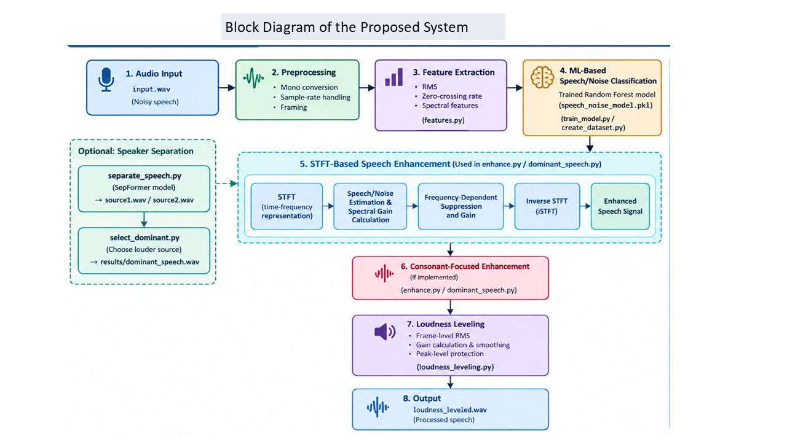
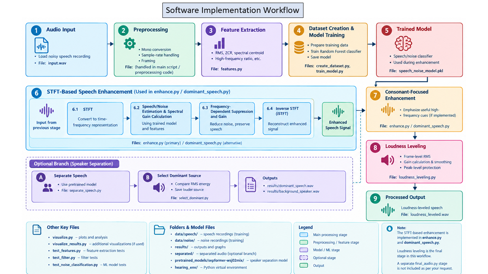

# Digital-Hearing-Aid-Speech-Clarifier
The system  combines  machine  learning  and Digital  Signal  Processing  (DSP)  to  reduce  background  noise  in speech  recordings.  A  Random  Forest  classifier  estimates  speech and  noise  activity,  while  an  STFT-based  algorithm  performs  noise suppression.  Loudness  leveling  is  used  to  reduce  variations  in audio volume.
# Digital Hearing Aid Speech Clarifier

An ML-assisted Digital Signal Processing (DSP) software prototype that explores ways to reduce background noise and improve the clarity of recorded speech.

> **Important:** This project is an experimental software prototype, not a physical hearing-aid device. It has not been clinically validated and is not intended to replace professional hearing care.

## Overview

Background noise and overlapping conversations can mask important speech sounds, including consonants, making speech harder to understand. The **Digital Hearing Aid Speech Clarifier** combines audio feature extraction, machine learning, and digital signal processing to investigate speech enhancement.

A Random Forest classifier estimates speech/noise activity from audio features. These estimates guide an STFT-based noise-suppression stage. Loudness leveling is used to reduce variations in output volume. An optional SepFormer-based module can be explored for separating overlapping speech sources.

The effectiveness of the system depends on the input audio, trained model, and processing settings. The results below are measurements from one reported test, not proof of clinical effectiveness or improved intelligibility.

## Objectives

- Develop a machine-learning-assisted DSP pipeline for speech enhancement.
- Estimate speech and noise activity in short audio frames.
- Reduce unwanted background noise while attempting to preserve useful speech information.
- Investigate preservation of consonant-related, high-frequency speech information.
- Apply loudness leveling to reduce volume variations.
- Explore optional separation of overlapping speech sources.
- Evaluate processed audio using waveforms, spectrograms, signal measurements, and listening tests.

## Proposed Methodology

### Processing workflow

```text
Input WAV Audio
      |
      v
Audio Loading and Preprocessing
      |
      v
Frame-Based Feature Extraction
(RMS, ZCR, Spectral Centroid, HF Ratio,
Bandwidth, Rolloff, Spectral Flatness)
      |
      v
Trained Random Forest Classifier
      |
      v
Speech/Noise Activity Estimation
      |
      v
STFT-Based Noise Suppression
      |
      v
Loudness Leveling
      |
      v
Enhanced WAV Output
```


## Audio Processing Parameters

The following are the intended/reported analysis settings; verify them against the final code before treating them as fixed implementation values.

| Parameter | Value |
|---|---|
| Sampling frequency | 16 kHz |
| Frame length | 20 ms |
| Hop length | 10 ms (160 samples at 16 kHz) |
| FFT size | 512 points |
| STFT window length | 320 samples |
| Analysis method | Short-Time Fourier Transform (STFT) |

## Extracted Audio Features

| Feature | Purpose |
|---|---|
| RMS energy | Measures the signal's short-time energy level. |
| Zero-crossing rate (ZCR) | Measures how often the waveform changes sign. |
| Spectral centroid | Indicates the centre of mass of the spectrum. |
| High-frequency energy ratio | Measures the proportion of energy in a selected high-frequency range (reported as 2–6 kHz). |
| Spectral bandwidth | Measures the spread of spectral energy around the centroid. |
| Spectral rolloff | Identifies the frequency below which a selected proportion of cumulative spectral energy lies (reported as 85%). |
| Spectral flatness | Helps describe whether a spectrum is noise-like or tone-like. |

## Software Requirements

| Software / Library | Purpose |
|---|---|
| Python | Main programming language |
| NumPy | Numerical computations |
| Librosa | Audio analysis and feature extraction |
| SoundFile | Reading and writing audio files |
| Scikit-learn | Random Forest training and evaluation |
| Joblib | Saving and loading the trained model |
| SciPy | Signal-processing operations, where used |
| SpeechBrain | Optional SepFormer-based speech separation |

## Implementation Modules

Module names below reflect the project structure described in the report. Check that each file is present in your repository and update this table if your final code uses different names.

| File / Module | Function |
|---|---|
| `feature.py` | Extracts audio features for classification. |
| `create_dataset.py` | Prepares labelled data for model training. |
| `train_model.py` | Trains and evaluates the Random Forest classifier. |
| `enhance.py` | Estimates speech/noise activity and performs noise suppression. |
| `loudness_leveling.py` | Adjusts audio loudness to reduce level variations. |
| Speech-separation module (optional) | Explores separation of overlapping speech using SepFormer. |
| `select_dominant.py` (optional) | Selects the separated source with the higher RMS level. |

## Installation

1. Install Python. Python 3.10 or 3.11 may be a practical starting point, but use a version compatible with the installed library versions and model dependencies.
2. Clone or download this repository.
3. Create and activate a virtual environment.

**Windows PowerShell**
```powershell
python -m venv hearing_env
.\hearing_env\Scripts\Activate.ps1
```

If PowerShell blocks script activation because of the execution policy, you can use Command Prompt instead:
```bat
hearing_env\Scripts\activate.bat
```

4. Install the libraries required by the modules you intend to run:
```bash
python -m pip install numpy librosa soundfile scikit-learn joblib scipy
```

For the optional SpeechBrain/SepFormer module, install a compatible version of SpeechBrain and its required dependencies separately. Speech-separation models can require substantial storage and processing resources.

## Usage

The exact commands depend on the files included in your repository and how the entry point is configured.

1. Place a supported input audio file, such as `input.wav`, in the location expected by the script.
2. Confirm that the audio is readable and that the sampling rate matches the assumptions made by the processing code. Resample when necessary; changing the sample-rate label alone does not resample audio.
3. Ensure the trained model file exists if the enhancement script loads a previously trained classifier.
4. Run the relevant script. For example, if `enhance.py` is configured as a standalone entry point:

```bash
python enhance.py
```

If the project is configured to run from `main.py`, use:

```bash
python main.py
```

5. Check the output file path printed by the script and listen to the original and processed recordings at a comfortable volume.

**Note:** These commands are examples. Use the entry point and filenames that actually exist in your repository. If the pipeline is intended to stop after loudness leveling, document and run only the stages implemented up to `loudness_leveling.py`.

## Reported Test Results

The following measurements were reported for one test using `input.wav`. They describe signal levels and classifier estimates; they do not, by themselves, measure speech intelligibility or prove that noise was removed successfully.

| Measurement | Reported value |
|---|---:|
| Input file | `input.wav` |
| Output file | `enhanced.wav` |
| Sampling rate | 16,000 Hz |
| Duration | 9.28 seconds |
| Input RMS | 0.124899 |
| Output RMS | 0.143574 |
| Input level | -18.07 dB |
| Output level | -16.86 dB |
| Overall RMS level change | +1.21 dB |
| Average speech probability | 0.822 |
| Maximum speech probability | 0.997 |
| Minimum speech probability | 0.275 |
| Noise-candidate frames | 11 |
| Minimum gain | -21.94 dB |
| Maximum gain | +2.58 dB |
| Average gain | +0.73 dB |

An increase in RMS level indicates a change in overall signal energy; it does not necessarily indicate better speech clarity. More evaluation—including listening tests and objective speech-quality measurements—is required.

## Evaluation

Suggested evaluation methods include:

- **Waveform comparison:** compare input and output signal amplitude over time.
- **Spectrogram comparison:** inspect how the time-frequency content changes after processing.
- **Signal-level measurements:** compare RMS and level changes.
- **Listening tests:** compare original and processed audio using consistent playback volume and varied noise conditions.
- **Noise-condition testing:** test recordings with different background sounds and signal-to-noise ratios.
- **Objective measures:** where suitable clean reference speech is available, consider metrics such as STOI or PESQ, observing their licensing and usage requirements.

Record the test conditions and limitations alongside each result. Do not infer improved intelligibility solely from a classifier probability or RMS change.

## Limitations

- This is a software prototype for recorded audio, not a completed hearing-aid device.
- Performance can vary with speakers, recording equipment, background noise, and audio format.
- Speech and noise may overlap in frequency, so filtering and suppression can also affect useful speech.
- A Random Forest's speech/noise estimate depends on the quality and diversity of its training data.
- Optional speech separation may require additional model downloads and computational resources.
- The project has not undergone clinical validation, formal safety assessment, or usability testing.

## Future Scope

- Improve preservation and intelligibility of consonants.
- Evaluate more advanced noise-suppression algorithms.
- Train and test with larger, more diverse speech and noise datasets.
- Reduce processing latency for possible real-time use.
- Explore integration with embedded hardware after performance and safety evaluation.
- Conduct structured listening tests and suitable objective speech-quality evaluations.
- Evaluate usability, output levels, and safety before considering any hearing-assistance application.

## Repository Structure

The structure may vary depending on which optional modules are included.

```text
Digital-Hearing-Aid-Speech-Clarifier/
├── feature.py
├── create_dataset.py
├── train_model.py
├── enhance.py
├── loudness_leveling.py
├── select_dominant.py        # optional
├── main.py                   # if used as the entry point
├── input.wav                 # sample input; include only if permitted
├── enhanced.wav              # generated output; usually do not commit
├── speech_noise_model.pkl   # trained model, if included
└── README.md
```

Update this example to match the files actually present in your GitHub repository. Avoid committing private recordings, large generated audio files, virtual environments, or model files that are too large or have redistribution restrictions.

## Acknowledgements

Developed as an academic project exploring machine learning and digital signal processing for speech enhancement.
